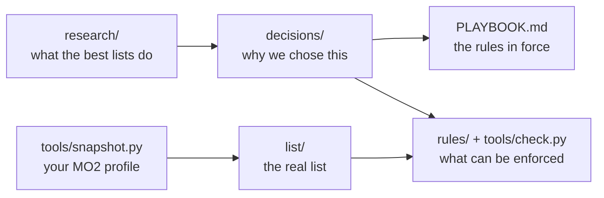

<div align="center">

# Skyrim Modlist Decisions

**Why this Skyrim SE list is built the way it is, written down before we forget.**

Curated modlists publish what changed. Almost none publish why, or what they turned down.<br>
This repository keeps the reasoning next to the real list, with a script that checks one against the other.

<br>

[](#decisions)
[](research/reference_list_structures.md)
[](decisions/0001-pin-skyrim-se-1597-with-cc.md)
[](https://github.com/ModOrganizer2/modorganizer)

**[Browse the site](https://ldallacqua.github.io/skyrim-modlist-decisions/)** · [Playbook](PLAYBOOK.md) · [Decisions](#decisions) · [The list](list/mods.csv) · [Research](research/) · [Changelog](CHANGELOG.md)

</div>

<br>

> [!NOTE]
> This is one person's list, not a guide to follow. [`list/`](list/) names every mod in it, including adult mods. It's a text list only, with no mod files or images.

## How it fits together



| Where | What it answers |
|---|---|
| [`PLAYBOOK.md`](PLAYBOOK.md) | What's the rule right now? Start here. |
| [`decisions/`](decisions/) | Why is it that way, and what would reopen it? |
| [`list/`](list/) | What's actually installed, generated from MO2. |
| [`mods/rejected.md`](mods/rejected.md) | What did we turn down, and when should we look again? |
| [`research/`](research/) | What did the evidence say? |
| [`CHANGELOG.md`](CHANGELOG.md) | What changed in each version, and is it save-safe? |
| [`AGENTS.md`](AGENTS.md) | How an AI assistant picks up the work: the machine, the tools, the pitfalls and what's in progress. |

## Decisions

**Accepted** describes the list as it is. **Proposed** would be a research-backed recommendation that hasn't been adopted yet; there are none right now. Entries marked "recorded after the fact" capture a choice made before this repository existed, so their original reasoning is limited.

| # | Decision | Status |
|---|---|---|
| [0001](decisions/0001-pin-skyrim-se-1597-with-cc.md) | Pin the game at Skyrim SE 1.5.97 with AE content | Accepted, after the fact |
| [0002](decisions/0002-separate-stock-game-folder.md) | Run from a separate game folder and test on a cloned profile | Accepted, after the fact |
| [0003](decisions/0003-function-based-unnumbered-separators.md) | Use function-based separators without numbers | Accepted |
| [0004](decisions/0004-character-pipeline-3ba-bodyslide-obody.md) | Build characters on CBBE 3BA, BodySlide and OBody NG | Accepted, after the fact |
| [0005](decisions/0005-pandora-behavior-engine.md) | Generate behaviors with Pandora | Accepted, after the fact |
| [0006](decisions/0006-community-shaders-renderer.md) | Render with Community Shaders | Accepted, after the fact |
| [0007](decisions/0007-one-output-mod-per-generator.md) | Give each generator its own output mod | Accepted |
| [0008](decisions/0008-configure-outputs-in-the-tool.md) | Set each generator's output in the tool, not only in MO2 | Accepted |
| [0009](decisions/0009-hybrid-patch-placement.md) | Place patches by what they connect | Accepted |
| [0010](decisions/0010-loot-with-metadata.md) | Sort with LOOT and record every exception as metadata | Accepted |
| [0011](decisions/0011-clean-plugins-with-backups.md) | Clean plugins in batch, with backups | Accepted |
| [0012](decisions/0012-inbox-separator-last.md) | Keep the inbox separator last | Accepted |
| [0013](decisions/0013-public-snapshot-by-whitelist.md) | Publish the real list, by whitelist, as text only | Accepted |
| [0014](decisions/0014-extended-grass-without-cache.md) | Extend grass with Grass Optimizations and NGIO, without a cache | Accepted |
| [0015](decisions/0015-keep-tomatorim-ground-and-northern-roads.md) | Keep TomatoRim's ground and Northern Roads at their own depths, and add road debris | Accepted |

New decisions start from the [template](decisions/0000-template.md). A decision gets a record when it's structural and expensive to reverse; a routine mod choice doesn't need one. Records are never deleted, only marked as superseded.

## What the research found

Based on real `modlist.txt` files from 25 lists, MO2's source code and each tool's documentation:

- **Numbering is optional.** 18 of 24 SE lists don't number their separators, and numbers drift in the lists that do.
- **Lists agree on the ends and disagree in the middle.** Foundation and fixes go on top; patches, outputs and optional items go at the bottom. Audio, gameplay, quests and weather move around between respected lists.
- **There's no standard size.** Lists run from 13 to 289 separators, with a median near 22 mods per separator.
- **Patches are hybrid.** Most sit near what they patch, and most lists also keep a late section for the rest.
- **Few lists record why.** No list we inspected publishes formal decision records, though the search wasn't exhaustive.

> [!IMPORTANT]
> These numbers show what lists do, not what works best. No source measures whether structure affects stability. Many of the files are user uploads that lag current releases, several lists share templates, and Nexus pages couldn't be read. Viva Skyrim couldn't be verified at all. The [notes](research/) mark what's verified and what isn't.

## Use it

```bash
python tools/snapshot.py "<MO2 folder>" Default
python tools/check.py
```

`snapshot.py` refreshes `list/` from a profile, copying only a fixed whitelist of files and fields. `check.py` needs nothing but Python and cites the decision behind each check. Run it before committing.

Nine more scripts do the work around the list:

- **`wabbajack.py`** counts what published lists install.
- **`coverage.py`** measures which vanilla assets still look vanilla.
- **`nexus.py`** looks mods up on Nexus Mods and downloads them with a premium API key.
- **`fomod.py`** reads and runs FOMOD installers with explicit choices.
- **`mo2.py`** installs, places and checks mods in an MO2 instance.
- **`mo2-run.ps1`** runs LOOT, PGPatcher or any MO2 executable with nobody at the keyboard.
- **`terrain_to_pbr.py`** converts an ENB complex parallax landscape texture into a Community Shaders PBR set.
- **`road_debris.py`** builds a small plugin that puts pebbles and small rocks on Northern Roads' dirt roads.
- **`terrain_depth.py`** stretches PBR ground height maps for deeper parallax. Its first output smeared in game and is turned off.

[`AGENTS.md`](AGENTS.md) shows how they fit together.

The [site](https://ldallacqua.github.io/skyrim-modlist-decisions/) is built from these same files, with Astro, React and Tailwind CSS. To preview it or publish it after a change:

```bash
cd site
npm install
npm run dev
npm run deploy
```

## Related

- [Clean Load Order](https://github.com/ldallacqua/clean-load-order-mo2): the batch plugin cleaner from [decision 0011](decisions/0011-clean-plugins-with-backups.md).
- [Ardósia](https://github.com/ldallacqua/ardosia-mo2): the MO2 theme this list runs on.

## License

Scripts are under [MIT](LICENSE). Documentation is under [CC BY 4.0](https://creativecommons.org/licenses/by/4.0/). Mods named here belong to their authors, and none of their files are included.
